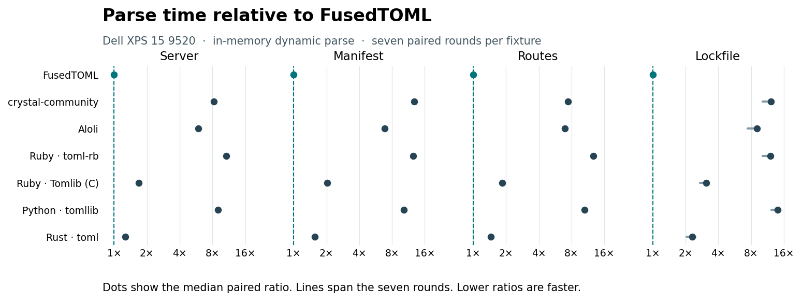

# TOML parsing across Crystal, Ruby, Python and Rust

Measured FusedTOML `84de66a` on a Dell XPS 15 9520 with a Core i9-12900HK. Each implementation parsed the same in-memory UTF-8 input into its public dynamic table type. All seven produced equivalent trees on all four inputs before timing. [Raw timings, tool versions and verification hashes](receipts/dell-cross-language-84de66a.json)

## Results

Median elapsed time per document across seven fresh processes. The first three columns are in microseconds. The lockfile column is in milliseconds.

| Implementation | Server · 169 B (µs) | Manifest · 294 B (µs) | Routes · 300 B (µs) | Lockfile · 318,461 B (ms) |
| --- | ---: | ---: | ---: | ---: |
| Crystal · FusedTOML `84de66a` | 3.89 | 4.20 | 4.66 | 2.84 |
| Crystal · crystal-community/toml.cr 0.8.1 | 31.86 | 53.64 | 34.34 | 34.57 |
| Crystal · Aloli 0.1.7 | 23.04 | 28.90 | 32.27 | 25.85 |
| Ruby · toml-rb 6.0.0 | 41.62 | 52.68 | 58.93 | 34.83 |
| Ruby · Tomlib 0.7.3 (C extension) | 6.52 | 8.53 | 8.57 | 9.02 |
| Python · tomllib | 34.88 | 43.17 | 48.61 | 39.92 |
| Rust · toml 1.2.1 | 4.95 | 6.58 | 6.76 | 6.68 |

On the 2,048-package lockfile, Aloli took 9.10× FusedTOML's time and crystal-community took 12.17×. Rust's `toml::Table` took 2.30×. Ratios are the median of the seven within-round comparisons.



## Workload and APIs

The three small inputs are the checked-in server, build-manifest, and route configurations. The generated lockfile uses the existing benchmark generator. These four TOML 1.0 inputs contain tables, arrays of tables, strings, booleans, integers and floats. Verification recursively serializes each complete tree and hashes sorted, canonical JSON outside the timed region. This preserves array order and scalar kinds for this corpus. Dates, TOML 1.1-only syntax, typed deserialization and writing require separate workloads. [Fixtures](../bench/fixtures) · [Lockfile generator](../bench/run.py)

- Crystal 1.22.3 used separate release binaries for `FusedTOML.load`, `TOML.parse` (crystal-community), and `TOML.parse_to_hash` (Aloli). The community shard returns a table of `TOML::Any` values. Aloli also builds a format-preserving document before producing its hash. Builds used LLVM 22.1.3 and `--release --no-debug --threads 1`. Measurement used `GC_MARKERS=1` and `GC_NPROCS=1`. [Community API](https://github.com/crystal-community/toml.cr/blob/030a3866af395bfb9fe2cce234d9b3d0d8f3ad3c/src/toml.cr) · [Aloli API](https://github.com/aloli-crystal/toml/blob/3cd645c67b83ce5b055bb0ae041d68fc354c7281/src/toml.cr)
- Ruby 4.0.9 ran without YJIT. Both `TomlRB.parse` (pure Ruby) and `Tomlib.load` (native C extension) returned Ruby hashes. [toml-rb](https://github.com/emancu/toml-rb) · [Tomlib](https://github.com/kgiszczak/tomlib)
- CPython 3.14.3 used the standard library's `tomllib.loads`. Rust 1.95.0 used `str::parse::<toml::Table>()` with the default features of `toml` 1.2.1+spec-1.1.0 and Cargo's release profile. [Python 3.14 API](https://docs.python.org/3.14/library/tomllib.html) · [Rust API](https://docs.rs/toml/1.2.1/toml/type.Table.html) · [Cargo.lock](../bench/cross_language/rust/Cargo.lock)

## Sampling and host conditions

Each round gave every implementation one fresh process per fixture. A cyclic order put each parser in each of the seven positions exactly once per fixture. Each worker read its input once, retained the last tree, warmed up for at least 0.5 seconds, and then measured at least one second in calibrated batches. Worker clocks covered repeated parsing and replacing the prior result. They excluded process startup, file reads, verification, interprocess messaging and printing. Cross-language memory use was outside the measurement.

The Dell stayed on AC. Workers were pinned to logical CPU 2 with SMT sibling 3 and the existing `powersave` governor. Before each round, a three-second sample required at least 95% true idle on each sibling, at least 95% host CPU time available (idle plus I/O wait), and at most 10% NVMe busy time. The host accounted for I/O wait on two other CPUs during the idle check. Each timed sample also had to meet the AC, sibling-idle, other-CPU availability and NVMe checks recorded by the runner. Across accepted samples the sibling was 99.4–100.0% idle and the disk was 0.0–0.3% busy. All 196 samples passed on the first attempt.

## Reproduce

Run on an AC-powered Linux host with NVMe, an SMT sibling for the chosen CPU, Git, Crystal, Cargo, Ruby with development headers, and Python with `tomllib`. Use the toolchain versions above to repeat this comparison. The preparation script builds dependencies in the supplied work directory. Use an appropriate CPU ID and paths to the Ruby and Python interpreters on that host.

```sh
work=$(mktemp -d)
ruby=$(command -v ruby)
python=$(command -v python3.14)
rev=84de66a3d3e02158aa38c2468a37a14fddd0eeff
sh bench/cross_language/prepare.sh "$work" "$rev" "$ruby"
python3 "$work/cross_language/run.py" --work "$work" --cpu 2 \
  --ruby "$ruby" --python "$python" --fused-rev "$rev" --output "$work/result.json"
```
